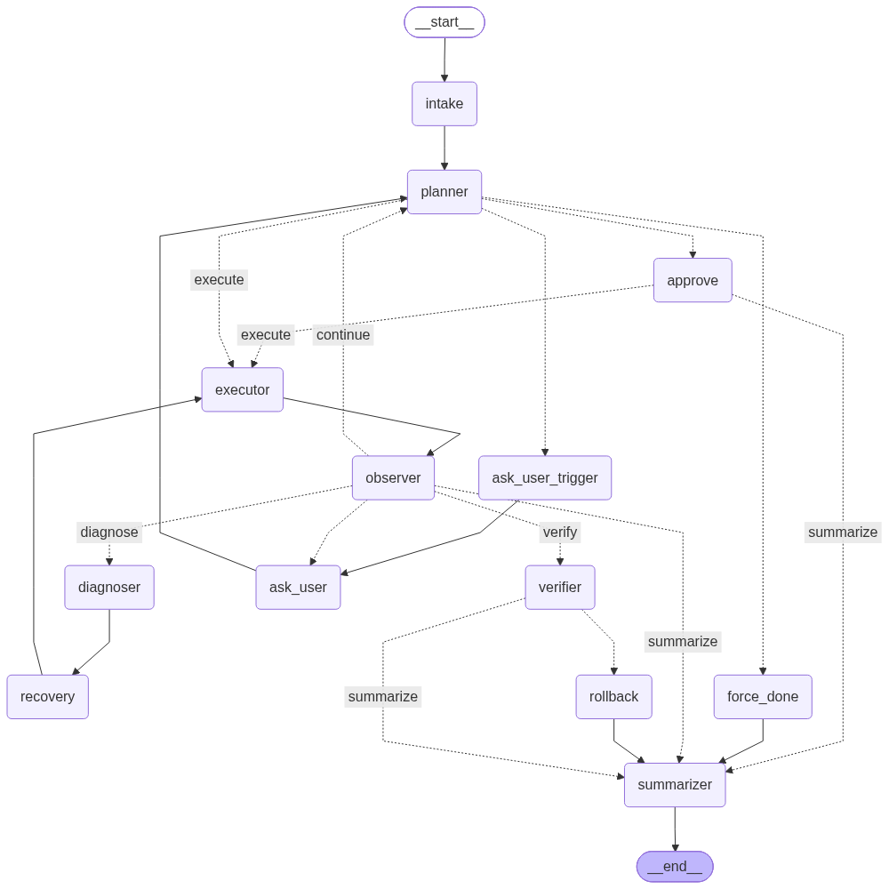

# AI Worker

An agent that takes a plain-English task ("read this invoice and enter it in the ERP") and tries to finish it on its own, using a browser, local files, and an API. I built it mostly to answer one question: what does it take to make an agent *reliable*, not just impressive in a demo?

So the interesting parts aren't the happy path. They're what happens when a file is missing, a selector breaks, the task is ambiguous, or the agent is about to do something expensive.

```bash
$ python -m agent.run "Fetch vendor V001 from the API and tell me their email"

TASK: Fetch vendor V001 from the API and tell me their email
GOAL: Retrieve vendor V001's email address from the API.

STEPS:
  [1] api_get_vendor   -> got entity V001
  [2] DONE             -> ok

WORLD MODEL:
Vendors:
  V001: Acme Corp (aliases: Acme Corporation, ACME) | email: ap@acme.com

SUMMARY:
  Fetched vendor V001 (Acme Corp). Email: ap@acme.com.

STATUS: done
```

## How it works



The agent is a ReAct-style loop built as a LangGraph state machine. Every run starts at `intake`, which turns the task into a one-line goal. From there it cycles: the **planner** picks one next action, the **executor** runs it, and the **observer** records what happened. A **router** then decides where to go next: keep planning, diagnose a failure, verify a write, or stop and ask the human.

| Node | What it does |
|---|---|
| `intake` | Turns the task into a clean one-line goal |
| `planner` | Asks the LLM for the single next action |
| `executor` | Runs the tool, catches every error, returns a uniform result |
| `observer` | Updates the world model and appends to history |
| `diagnoser` | Sorts failures into a fixed taxonomy |
| `recovery` | Picks a fix, from memory first, then the LLM |
| `verifier` | Reads back what was written and compares it to the intent |
| `rollback` | Undoes a bad write with a compensating action |
| `approve` | Pauses for human approval on risky actions |
| `ask_user` | Pauses for clarification when the task is ambiguous |
| `force_done` | Shuts down cleanly if a loop is detected |
| `summarizer` | Writes the final report |

### Tools

Every tool returns the same shape, `{success, result, error}`. That sounds boring, but it's what lets the observer, diagnoser and router handle any tool without special cases.

- **Files:** `list_files`, `read_file`, `write_file`
- **Browser (Playwright):** `browser_open`, `browser_fill`, `browser_click`, `browser_read`, `browser_screenshot`
- **API (httpx):** `api_get`, `api_post`, `api_get_invoice`, `api_create_invoice`, `api_get_vendor`, `api_get_po`, `api_create_expense`, `api_get_expense`, `api_get_employee`, `api_send_email`
- **Meta:** `remember`

### Memory

There are three separate memories because they live for different amounts of time.

- **World model** (one run): typed knowledge about vendors, POs, invoices, files, facts and open uncertainties.
- **Recovery memory** (all runs): fixes that worked before, stored in SQLite and ChromaDB.
- **Checkpointer** (one run): state snapshots in SQLite, used for replay and for resuming after a human pause.

### The mock company

The agent doesn't touch anything real. It works against a small fake company:

- a FastAPI + SQLite backend (`mock_env/api/`)
- HTML pages for the browser to drive (`mock_env/web/templates/`)
- files to read and write (`mock_env/files/`)

## Getting it running

You'll need Python 3.10+ and a [Groq API key](https://console.groq.com). A [LangSmith](https://smith.langchain.com) key is optional, but I'd recommend it, because being able to see every LLM call makes debugging much less painful.

```bash
git clone <your-repo-url>
cd ai-worker

python -m venv venv
source venv/bin/activate          # Windows: venv\Scripts\activate

pip install -r requirements.txt
playwright install chromium
```

Create a `.env` file in the project root:

```bash
GROQ_API_KEY=your_groq_key_here
LANGCHAIN_TRACING_V2=true
LANGCHAIN_API_KEY=your_langsmith_key_here
LANGCHAIN_PROJECT=ai-worker
```

Seed the mock database:

```bash
python -m mock_env.api.seed
```

### Run it

Start the mock company server in one terminal:

```bash
uvicorn mock_env.api.main:app --port 8000
```

Quick check that it's up:

```bash
curl http://localhost:8000/api/health
# {"status":"ok"}
```

The API docs are at http://localhost:8000/docs and the ERP form is at http://localhost:8000/app/erp.

Then, in a second terminal, give the agent a task:

```bash
python -m agent.run "your task here"
```

## Things to try

Each of these exercises a different part of the system.

```bash
# Simple lookup
python -m agent.run "Fetch vendor V001 from the API and tell me their email"

# Multi-step, uses the world model
python -m agent.run "Fetch vendor V001, then fetch purchase order PO-1001, and tell me which vendor the PO belongs to"

# Browser automation + verification
python -m agent.run "Read invoices/acme_inv_001.txt, open /app/erp, fill the form with the invoice data, and click submit"

# Failure recovery (the file doesn't exist)
python -m agent.run "Read invoices/does_not_exist.txt and tell me what it contains"

# Human approval (high-value action)
python -m agent.run "Use the API to create invoice INV-900 for V001 with amount 250000"

# Clarification (ambiguous input)
python -m agent.run "Find the Acme vendor's email"
```

## Design decisions

A few choices that shaped the project, and why I made them.

**I parse JSON myself instead of using `bind_tools`.** The tool descriptions live in the prompt and the LLM answers with JSON that I parse. This makes every step easy to read in LangSmith, lets me add my own fields like a `reason` and control signals like `DONE`, and means malformed JSON gets handled instead of crashing the run. Moving to native tool calling later would be straightforward.

**The planner only picks the next step.** There's no big upfront plan. Real environments change under you, and a plan made before the first action goes stale fast. Deciding one step at a time, based on what just happened, is what makes this an agent rather than a script.

**Verification is deterministic.** After a write, the verifier reads the record back and compares fields with `==`. If the amount should be 5000, it checks for 5000. I didn't want an LLM deciding whether something "looks right."

**Recovery checks memory before the LLM.** When something fails, the agent first looks in ChromaDB for a strategy that worked on a similar failure. That makes repeat problems faster and cheaper over time.

**The world model is typed.** Entities are Pydantic models with a `to_prompt_text()` method for feeding the LLM, plus typed helpers like `find_vendor_by_name`. It's more code than a dict, but it catches mistakes early.

**Checkpointing came first.** I added the SQLite checkpointer before I needed it for human-in-the-loop, so pausing and resuming worked without a refactor, and every run can be replayed.

**Human decisions are final.** If the user rejects an action or cancels, the node sets `status=failed` and `next_action=DONE`, and the graph goes straight to the summarizer. The planner never sees it, so it can't mistake a "no" for a suggestion.

**A guard layer catches loops.** `guard.py` tracks failed action signatures and questions already asked. The executor and `ask_user` check it before acting, so the agent can't get stuck repeating itself no matter what the LLM proposes.

## Failure handling

Failures get sorted into one of these categories:

```
selector_not_found   api_500              timeout
missing_field        duplicate_record     permission_denied
ambiguous_data       file_not_found       validation_error
redundant_action     unknown
```

Each one gets a canonical signature, like `file_not_found::read_file::invoices/ghost.txt`. When a recovery works, it's saved to memory and later retrieved with a similarity search filtered by category.

## Human in the loop

Both flows use LangGraph's `interrupt()`, and the checkpointer holds the state while the graph waits.

- **Approval:** a rule-based risk assessor scores each action from 0 to 1. Anything above 0.7 pauses the run and shows you the action, the score and the evidence. You approve or reject.
- **Clarification:** when the planner can't proceed because the task is ambiguous, it emits `ASK_USER` and the graph pauses. Your answer is saved as a fact in the world model.

## Known limitations

- Recovery memory can store weak strategies. The category filter and the verifier catch the worst ones, but cleanup is manual for now.
- There's no streaming UI. The CLI waits for the whole run to finish.
- It's single-user and handles one-shot tasks only.
- The document extractor truncates at 4000 characters.
- The mock API has no auth.
- The SQLite checkpointer doesn't handle concurrent writers well.

## Tech stack

| Layer | Choice |
|---|---|
| LLM | ChatGroq (`llama-3.3-70b-versatile`) |
| Agent framework | LangGraph |
| Tracing | LangSmith |
| Browser | Playwright |
| API | FastAPI + SQLAlchemy + SQLite |
| Vector store | ChromaDB |
| Validation | Pydantic v2 |

## What I'd do next

- Try other kinds of tasks, like expense reports and research-and-compile jobs, on the same core loop.
- Build a Streamlit UI with live step streaming and in-browser approvals.
- Write an evaluation harness with 15 to 50 chaos scenarios, tracking success rate, recovery rate and cost.
- Split the work across specialist sub-agents with the planner as dispatcher.
- Harden it for production: auth, rate limiting, structured logging, and a policy engine like OPA.

## Assumptions

- The mock environment runs on `localhost:8000`.
- Whoever runs it has their own Groq API key.
- All data is local and simulated. No real credentials are involved.
- Chromium has been installed with `playwright install chromium`.

## Links

- Demo video: (link)
- LangSmith Trace Example: [View Trace](https://smith.langchain.com/public/03218293-ebab-4026-86f5-7f51b43aa3a3/r/01a12128-c839-7d53-8bb7-8d2b159c05df?start_time=2026-10-09T14%3A54%3A43.257431Z)